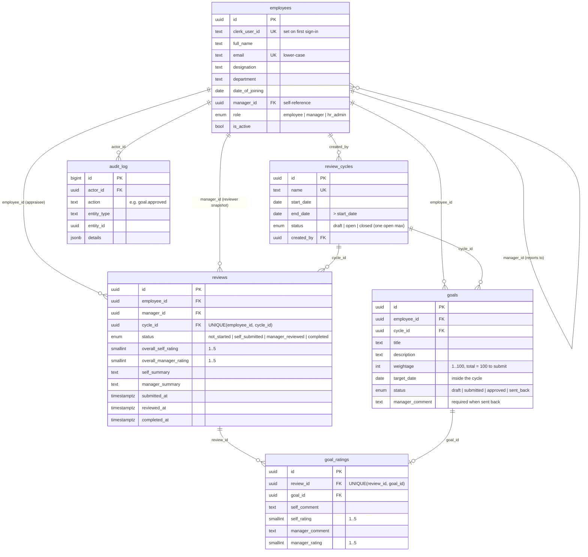

# Data model

GitHub renders this Mermaid diagram automatically. The SQL lives in [`supabase/schema.sql`](../supabase/schema.sql).

## Changes from the manual's suggested model, and why

| Change | Why |
|---|---|
| `audit_log` table (6th table) | The problem statement says the record must be **auditable**: who approved, sent back or completed what, and when. |
| `reviews.self_summary`, `completed_at` | Separate timestamps for each workflow step let reports show *when* each stage happened. |
| `review_cycles.opened_at / closed_at` | Audit of the cycle itself. |
| Postgres `enum` types for every status | The database rejects an invalid status even if the app has a bug. |
| Partial unique index `review_cycles_one_open` | "Only one cycle open at a time" is enforced by the DB, not just the UI. |
| `UNIQUE(employee_id, cycle_id)` on reviews | Exactly one review per employee per cycle. |
| `CHECK (manager_id <> id)` | Nobody can be their own manager. Deeper loops (A→B→A) are blocked in the server action. |
| `reviews.manager_id` = snapshot of the reviewer | History stays correct when someone later changes manager. During an *open* cycle, reassigning a manager moves unfinished reviews to the new manager. |
| Ratings live in `goal_ratings`, not `goals` | A goal is the **plan**, a rating is the **outcome** (the manual's "things students get wrong"). |
| RLS on, no public policies | The anon key can read nothing. All access goes through server code that checks the user first. |
